

# RIFT

### Your phone is the console. Your body is the controller.

Jump, duck, punch, swing and slice your way through the games already on your phone. 
No extra hardware. No account. Nothing leaves your phone.

 

&nbsp;

&nbsp;

  

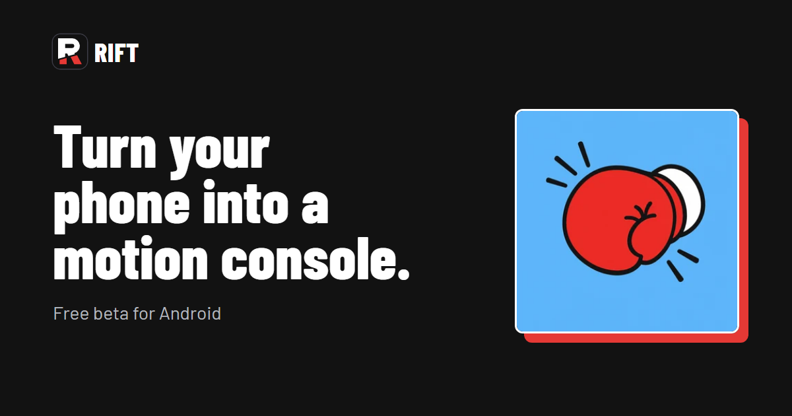

 

## 🎮 Pick a game, then move

**Tested and tuned:**

<table>
  <tr>
    <td align="center" width="20%">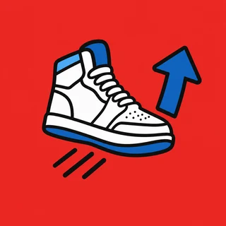 <b>Subway Surfers</b> 📷 Camera Jump, duck, lean to switch lanes</td>
    <td align="center" width="20%">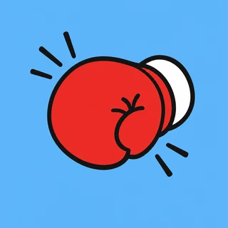 <b>Real Boxing 2</b> 📷 Camera Throw real punches, cover up to block</td>
    <td align="center" width="20%">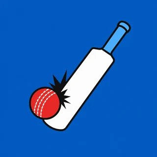 <b>World Cricket Championship 3</b> 📱 Phone bat or ✋ hand Swing like a bat</td>
    <td align="center" width="20%">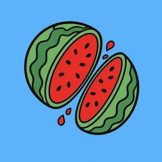 <b>Fruit Ninja</b> 📱 Phone blade or ✋ hand Point and slice</td>
    <td align="center" width="20%">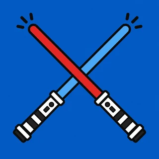 <b>Beat Swiper</b> 📱📱 Two phones A saber in each hand</td>
  </tr>
</table>

**🧪 Also playable, experimental:** mapped and ready to try, not fully tested yet. Tell us how they play!

| | |
|---|---|
| 🏃 **Runners** | Temple Run 2, Temple Run, Minion Rush, Sonic Dash |
| 👆 **One-tap** | Geometry Dash Lite, Jetpack Joyride, Stack, Crossy Road |
| 🏎️ **Racing** | Hill Climb Racing, Hill Climb Racing 2, Traffic Rider, Traffic Racer, Smashy Road: Wanted, Beach Buggy Racing 2 |
| 🏏 **Cricket** | Stick Cricket Classic, World Cricket Championship 2, Real Cricket 20 |

Install the game from the Play Store and RIFT finds it by itself. Want another game? [Ask for it](https://github.com/Crisiswastaken/rift-app/issues/new?template=game_request.yml).

## ⚡ How it works

<table>
  <tr>
    <td align="center" width="25%">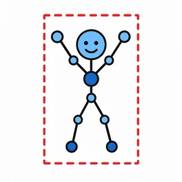 <b>1. It sees you</b> The camera tracks your body, right on the phone.</td>
    <td align="center" width="25%">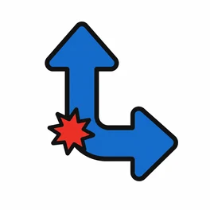 <b>2. It reads the move</b> A jump, a punch, a swing, a lean.</td>
    <td align="center" width="25%">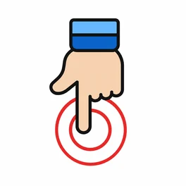 <b>3. It taps for you</b> The matching swipe or tap lands in the game.</td>
    <td align="center" width="25%">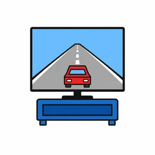 <b>4. You just play</b> On the phone, or on your TV.</td>
  </tr>
</table>

## 🚀 Get started in 5 minutes

<table>
  <tr>
    <td width="170" align="center">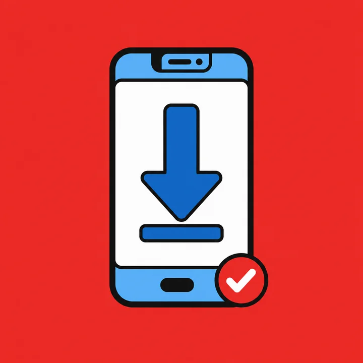</td>
    <td>

**1. Install RIFT.** Grab the APK from [Releases](https://github.com/Crisiswastaken/rift-app/releases/latest) and open it on your phone. Android asks to allow
installs from your browser. That's normal for apps outside the Play Store.

**2. Follow the setup.** RIFT walks you through it: allow the camera, and turn on RIFT in Accessibility settings (that's
how it taps the game). Every step shows you exactly where to go.

</td>
  </tr>
  <tr>
    <td width="170" align="center">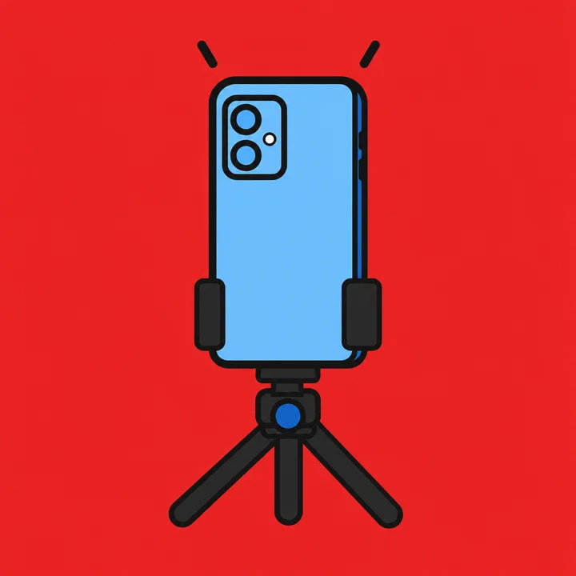</td>
    <td>

**3. Stand the phone up** 2 to 3 metres away, camera facing you. A tripod, a shelf or a pile of books all work.

**4. Calibrate once, then hit Play.** A short calibration teaches RIFT how *you* move. Cast to your TV if you like.

</td>
  </tr>
</table>

### 🟢 The light in the game

While you play, a light at the top of the game tells you what's up, big enough to read from across the room:

| | |
|---|---|
| 🟢 **Green** | All good, go! In Subway Surfers, boxing and cricket your moves flash on it too, like **⬆ Jump**. |
| 🟠 **Amber** | Adjust something, like **Step back** or **Stand still**. |
| 🔴 **Red** | Something needs fixing first, like **Step into view**. |

### 📱 Use a second phone as a controller

For the cricket bat, the Fruit Ninja blade or the Beat Swiper sabers, install RIFT on the other phone too and pick
**Use this phone as a controller**. Put both phones on the same Wi-Fi and type the 4-digit code from the game phone.
After that they find each other by themselves.

## 🎬 See where it's going

  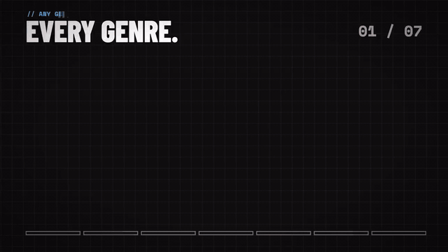 
  Full film on <a href="https://www.tryrift.fun">tryrift.fun</a>.

## 💡 Tips for the best game

- 💡 **Bright room, nothing bright behind you.** A window at your back makes tracking harder.
- 📺 **Play on a TV** with a USB-C to HDMI cable or screen casting, so you can see the game from where you stand.
- 🔋 **Keep RIFT running.** Set its battery use to Unrestricted. On some phones (vivo, iQOO, Xiaomi, OPPO) also allow
  auto-start.
- 🛑 **Done?** Swipe RIFT away from your recent apps or tap Stop in its notification. It also stops by itself after a
  few minutes without a game, so it won't drain your battery.

## 🔒 Privacy

The camera picture is processed on your phone and never leaves it. RIFT has no account and no servers. The controller
phone talks to the game phone directly over your own Wi-Fi.

## 🐛 Something not working?

[Open an issue](https://github.com/Crisiswastaken/rift-app/issues/new/choose) with your phone model, the game, and what happened. A short video helps a lot.

 
 
Made for people who'd rather move than tap.

