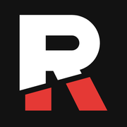

# Rift

  

Android app. Your phone watches you move and plays the games already on it. The camera frame is thrown away after the pose. No account. Nothing is uploaded.

This repo is the public download and the issue tracker. The app source is not here. APKs are GitHub Releases, not commits.

**[Download the APK](https://github.com/Crisiswastaken/rift-app/releases/latest)** · [tryrift.fun](https://tryrift.fun) · [Report a problem](https://github.com/Crisiswastaken/rift-app/issues/new/choose)

| | |
|---|---|
| Current release | `v0.3-beta` (`RIFT-0.3-beta.apk`). The website's `/rift.apk` redirect is pinned to that asset |
| Android | 11 or newer |
| Install | Open the APK. Allow install from the browser. Turn on the Rift Accessibility service (that is how taps reach the game) and the camera |
| Play | Phone upright, 2–3 m away, camera facing you. No calibration |
| Second phone | Cricket bat, Fruit Ninja blade, Beat Swiper sabers, tennis racket. Same version on both phones. 4-digit code. Wi-Fi Direct on Android 13+, otherwise the same Wi-Fi or the game phone's hotspot |

## Tested in 0.3-beta

| Game | How |
|---|---|
| Subway Surfers, Minion Rush, Sonic Dash | Camera. Jump, duck, lean |
| Traffic Rider | Lean to steer, head down to brake |
| Asphalt 8 | Both fists as a wheel. In the game: Settings, Controls, Tap to steer |
| World Cricket Championship 3 | Second phone as the bat, or your hand |
| Fruit Ninja | Second phone as the blade, or your hand |
| Beat Swiper | A phone in each hand |
| Real Boxing 2 | Camera. Punch, cover to block, lean to dodge |

Other mapped games are marked Experimental in the app. Install the game from the Play Store and Rift finds it.

## Issues

Use the templates. Include the phone model, the Rift version, the game, and what happened. A short video is the useful attachment.

| Kind | Template |
|---|---|
| Bug | `.github/ISSUE_TEMPLATE/bug_report.yml` |
| Game request | `.github/ISSUE_TEMPLATE/game_request.yml` |

## Brand

Rift, Rift Arcade, and Rift Gym share one mark. Black `#1A1A1A`, Chalk `#F4F4F0`, White. Logos are black or white. Plus Jakarta Sans. The pictures in `assets/` are the current release art.
